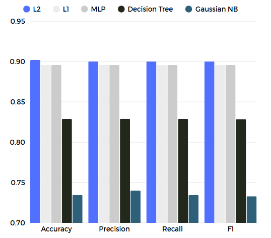
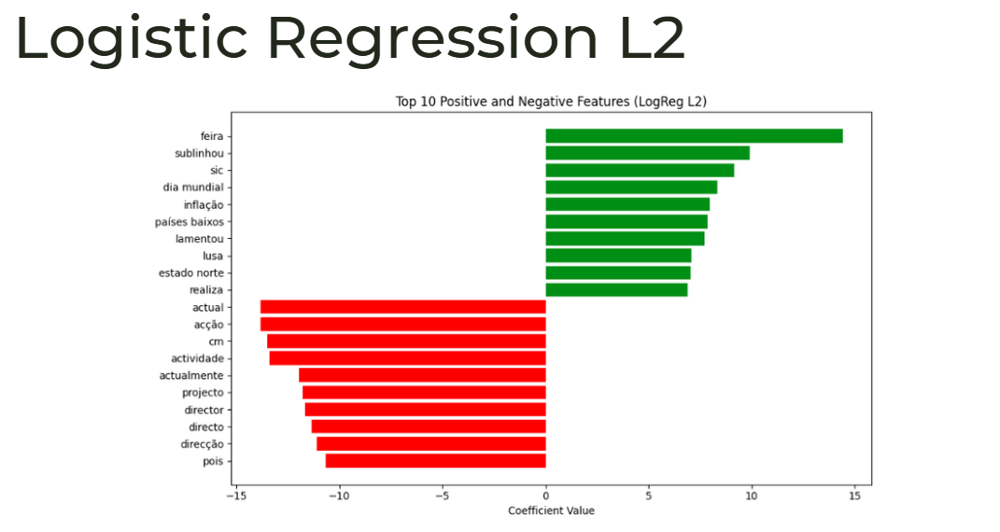

# Portuguese Fake News Detection

**ML Merit Prize winner – NTT Data & Instituto Superior Técnico, 2025/2026**

A machine learning pipeline that classifies Portuguese news articles as **real or fake**, with explanations for each prediction.

## Results

The best model, **logistic regression with L2 regularisation**, reached about **90% accuracy and F1** and a **ROC AUC of 0.96** on the test set.



## How it works

1. **Text cleaning:** removes punctuation, digits and Portuguese stopwords (NLTK, plus temporal terms such as months and weekdays), lowercases the text and normalises spacing.
2. **Features:** TF-IDF on phrases of 1–3 words, keeping the 5,000 most informative terms and ignoring terms that appear in fewer than 10 articles or in more than 90% of them.
3. **Model selection:** five models compared (logistic regression with L1 and L2, MLP, decision tree, Gaussian Naive Bayes), each tuned with grid search and 5-fold cross-validation.
4. **Explainability:** LIME shows which words push an individual article towards "fake" or "real".
5. **Topic clustering:** K-means groups the articles into 5 topics, zero-shot classification labels each cluster automatically, and PCA visualises the data in 2D.



## Tech stack

Python, scikit-learn, NLTK, LIME, Jupyter

## Authors

- Bernardo Lopes ([GitHub](https://github.com/bennyc0de))
- Rodrigo Zink ([GitHub](https://github.com/Zinko0))

## Running the project

1. Make sure you have **Python 3.12+** installed.
2. (Recommended) Create and activate a virtual environment:
   ```bash
   python3 -m venv venv
   source venv/bin/activate
   ```
3. Install Jupyter Notebook:
   ```bash
   pip install notebook
   ```
4. Open `NN.ipynb` and run the cells in order from top to bottom. The notebook installs the dependencies (`pip install -r requirements.txt`) and downloads the NLTK stopwords.

**Notes**
- The data is in `Data_Set/` and results are saved to `cv_results/`. Don't rename or move these folders.
- The datasets are too large to include pre-processed, so the notebook parses and cleans them on the first run.
- The trained models and TF-IDF vectorizer are already saved, but you can retrain them from the notebook.

## References

- [scikit-learn](https://scikit-learn.org/)
- [LIME](https://github.com/marcotcr/lime)
